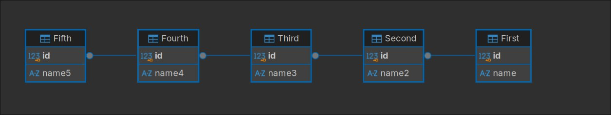
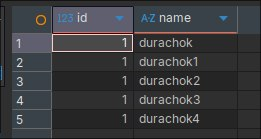

# Лабораторная работа. Проектирование БД: связанные таблицы и выборка строк на T-SQL

Создание базы данных из пяти связанных таблиц с помощью FOREIGN KEY и выборка по одной строке из каждой таблицы.

---

## Задание. Создание БД из 5 связанных таблиц и выборка строк

### Что требовалось
Создать собственную базу данных с пятью и более таблицами, каждая из которых связана с другой. Достать из каждой таблицы по одной строке с помощью T-SQL. Загрузить БД в репозиторий вместе с диаграммой БД и скриншотом вывода строк.

### Что сделано
Создана база данных `hw` из пяти таблиц: `First`, `Second`, `Third`, `Fourth`, `Fifth`. Таблицы связаны в цепочку: `Second → First`, `Third → Second`, `Fourth → Third`, `Fifth → Fourth`. Связь реализована через `FOREIGN KEY` на собственный `id` таблицы, ссылающийся на `id` родительской таблицы.

База создаётся отдельной командой:

```sql
CREATE DATABASE hw;
```

Создание таблиц:

```sql
use hw;

create TABLE First (
	id INT IDENTITY(1,1) PRIMARY KEY,
	name NVARCHAR(20) not null
);

create TABLE Second (
	id INT IDENTITY(1,1) PRIMARY KEY,
	name2 NVARCHAR(20) not null,
	CONSTRAINT fk_second_first FOREIGN KEY (id) REFERENCES First(id)
);

create TABLE Third (
	id INT IDENTITY(1,1) PRIMARY KEY,
	name3 NVARCHAR(20) not null,
	CONSTRAINT fk_third_second FOREIGN KEY (id) REFERENCES Second(id)
);

create TABLE Fourth (
	id INT IDENTITY(1,1) PRIMARY KEY,
	name4 NVARCHAR(20) not null,
	CONSTRAINT fk_fourth_third FOREIGN KEY (id) REFERENCES Third(id)
);

create TABLE Fifth (
	id INT IDENTITY(1,1) PRIMARY KEY,
	name5 NVARCHAR(20) not null,
	CONSTRAINT fk_fifth_fourth FOREIGN KEY (id) REFERENCES Fourth(id)
);
```

Заполнение таблиц (вставка идёт от родительской таблицы к дочерним):

```sql
INSERT INTO First  (name)  VALUES (N'durachok'),  (N'ishak'),  (N'duraley');
INSERT INTO Second (name2) VALUES (N'durachok1'), (N'ishak1'), (N'duraley1');
INSERT INTO Third  (name3) VALUES (N'durachok2'), (N'ishak2'), (N'duraley2');
INSERT INTO Fourth (name4) VALUES (N'durachok3'), (N'ishak3'), (N'duraley3');
INSERT INTO Fifth  (name5) VALUES (N'durachok4'), (N'ishak4'), (N'duraley4');
```

Выборка по одной строке из каждой таблицы:

```sql
SELECT TOP 1 id, name  FROM First
UNION ALL
SELECT TOP 1 id, name2 FROM Second
UNION ALL
SELECT TOP 1 id, name3 FROM Third
UNION ALL
SELECT TOP 1 id, name4 FROM Fourth
UNION ALL
SELECT TOP 1 id, name5 FROM Fifth;
```

### Диаграмма БД



### Результат

Запрос возвращает по одной строке из каждой таблицы:

| id | name |
|---|---|
| 1 | durachok |
| 1 | durachok1 |
| 1 | durachok2 |
| 1 | durachok3 |
| 1 | durachok4 |



### Анализ
- `PRIMARY KEY` однозначно идентифицирует строку, `IDENTITY(1,1)` автоматически генерирует значения `id`.
- `FOREIGN KEY (id) REFERENCES ...` — внешний ключ проверяет, что в родительской таблице существует строка с таким же `id`. Поэтому данные вставляются строго от родительской таблицы к дочерним.
- `SELECT TOP 1` ограничивает выборку одной строкой.
- `UNION ALL` объединяет результаты пяти запросов друг под другом. Требуется одинаковое число столбцов и совместимые типы, поэтому выбираются `id` и имя, а имена столбцов берутся из первого запроса. В отличие от `UNION`, дубликаты не удаляются.
- `TOP 1` без `ORDER BY` возвращает произвольную строку. Для предсказуемого результата нужно добавлять сортировку.

### Вывод
Реализована база данных из пяти связанных таблиц. Связи заданы внешними ключами, которые гарантируют целостность данных, а по одной строке из каждой таблицы получено с помощью `SELECT TOP 1` и `UNION ALL`.

---

## Стек

Microsoft SQL Server, DBeaver.
