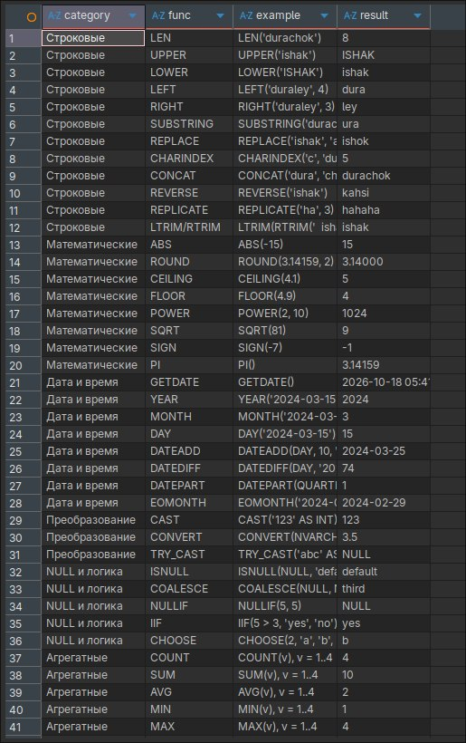
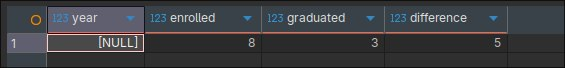

# Лабораторная работа. Функции и хранимые процедуры в T-SQL

Создание пользовательской функции, демонстрирующей встроенные функции SQL Server, и хранимой процедуры, считающей разницу между поступившими и выпустившимися студентами.

---

## Задание. Функция и процедура

### Что требовалось
Создать функцию, которая показывает примеры встроенных функций, и процедуру, которая считает разницу между выпустившимися и поступившими студентами. В репозиторий загрузить скриншот, на котором видны код и результат.

### Что сделано
Создана таблица `Students` с датами поступления и выпуска (`graduation_date` равна `NULL`, если студент ещё не выпустился):

```sql
use hw;

create TABLE Students (
	id INT IDENTITY(1,1) PRIMARY KEY,
	name NVARCHAR(50) not null,
	enrollment_date DATE not null,
	graduation_date DATE null
);

INSERT INTO Students (name, enrollment_date, graduation_date) VALUES
(N'Ivan',    '2020-09-01', '2024-06-30'),
(N'Petr',    '2020-09-01', '2024-06-30'),
(N'Anna',    '2020-09-01', NULL),
(N'Olga',    '2021-09-01', '2025-06-30'),
(N'Dmitry',  '2021-09-01', NULL),
(N'Maria',   '2022-09-01', NULL),
(N'Alexey',  '2022-09-01', NULL),
(N'Sergey',  '2023-09-01', NULL);
```

#### Функция

Табличная функция возвращает набор строк: категория, название встроенной функции, пример вызова и результат. Перечислить абсолютно все встроенные функции SQL Server невозможно (их сотни), поэтому показаны основные функции по категориям: строковые, математические, даты и времени, преобразования, работы с `NULL` и логические, агрегатные.

```sql
create FUNCTION dbo.fn_BuiltInFunctionsDemo()
RETURNS @t TABLE (
	category NVARCHAR(20),
	func     NVARCHAR(30),
	example  NVARCHAR(80),
	result   NVARCHAR(100)
)
AS
BEGIN
	INSERT INTO @t VALUES
	(N'Строковые', N'LEN',       N'LEN(''durachok'')',               CAST(LEN('durachok') AS NVARCHAR(100))),
	(N'Строковые', N'UPPER',     N'UPPER(''ishak'')',                UPPER('ishak')),
	(N'Строковые', N'LOWER',     N'LOWER(''ISHAK'')',                LOWER('ISHAK')),
	(N'Строковые', N'LEFT',      N'LEFT(''duraley'', 4)',            LEFT('duraley', 4)),
	(N'Строковые', N'RIGHT',     N'RIGHT(''duraley'', 3)',           RIGHT('duraley', 3)),
	(N'Строковые', N'SUBSTRING', N'SUBSTRING(''durachok'', 2, 3)',   SUBSTRING('durachok', 2, 3)),
	(N'Строковые', N'REPLACE',   N'REPLACE(''ishak'', ''a'', ''o'')', REPLACE('ishak', 'a', 'o')),
	(N'Строковые', N'CHARINDEX', N'CHARINDEX(''c'', ''durachok'')',  CAST(CHARINDEX('c', 'durachok') AS NVARCHAR(100))),
	(N'Строковые', N'CONCAT',    N'CONCAT(''dura'', ''chok'')',      CONCAT('dura', 'chok')),
	(N'Строковые', N'REVERSE',   N'REVERSE(''ishak'')',              REVERSE('ishak')),
	(N'Строковые', N'REPLICATE', N'REPLICATE(''ha'', 3)',            REPLICATE('ha', 3)),
	(N'Строковые', N'LTRIM/RTRIM', N'LTRIM(RTRIM(''  ishak  ''))',   LTRIM(RTRIM('  ishak  ')));

	INSERT INTO @t VALUES
	(N'Математические', N'ABS',     N'ABS(-15)',          CAST(ABS(-15) AS NVARCHAR(100))),
	(N'Математические', N'ROUND',   N'ROUND(3.14159, 2)', CAST(ROUND(3.14159, 2) AS NVARCHAR(100))),
	(N'Математические', N'CEILING', N'CEILING(4.1)',      CAST(CEILING(4.1) AS NVARCHAR(100))),
	(N'Математические', N'FLOOR',   N'FLOOR(4.9)',        CAST(FLOOR(4.9) AS NVARCHAR(100))),
	(N'Математические', N'POWER',   N'POWER(2, 10)',      CAST(POWER(2, 10) AS NVARCHAR(100))),
	(N'Математические', N'SQRT',    N'SQRT(81)',          CAST(SQRT(81) AS NVARCHAR(100))),
	(N'Математические', N'SIGN',    N'SIGN(-7)',          CAST(SIGN(-7) AS NVARCHAR(100))),
	(N'Математические', N'PI',      N'PI()',              CAST(PI() AS NVARCHAR(100)));

	INSERT INTO @t VALUES
	(N'Дата и время', N'GETDATE',  N'GETDATE()',                           CONVERT(NVARCHAR(100), GETDATE(), 120)),
	(N'Дата и время', N'YEAR',     N'YEAR(''2024-03-15'')',                CAST(YEAR('2024-03-15') AS NVARCHAR(100))),
	(N'Дата и время', N'MONTH',    N'MONTH(''2024-03-15'')',               CAST(MONTH('2024-03-15') AS NVARCHAR(100))),
	(N'Дата и время', N'DAY',      N'DAY(''2024-03-15'')',                 CAST(DAY('2024-03-15') AS NVARCHAR(100))),
	(N'Дата и время', N'DATEADD',  N'DATEADD(DAY, 10, ''2024-03-15'')',    CONVERT(NVARCHAR(100), DATEADD(DAY, 10, '2024-03-15'), 23)),
	(N'Дата и время', N'DATEDIFF', N'DATEDIFF(DAY, ''2024-01-01'', ''2024-03-15'')', CAST(DATEDIFF(DAY, '2024-01-01', '2024-03-15') AS NVARCHAR(100))),
	(N'Дата и время', N'DATEPART', N'DATEPART(QUARTER, ''2024-03-15'')',   CAST(DATEPART(QUARTER, '2024-03-15') AS NVARCHAR(100))),
	(N'Дата и время', N'EOMONTH',  N'EOMONTH(''2024-02-10'')',             CONVERT(NVARCHAR(100), EOMONTH('2024-02-10'), 23));

	INSERT INTO @t VALUES
	(N'Преобразование', N'CAST',     N'CAST(''123'' AS INT)',          CAST(CAST('123' AS INT) AS NVARCHAR(100))),
	(N'Преобразование', N'CONVERT',  N'CONVERT(NVARCHAR, 3.5)',        CONVERT(NVARCHAR(100), 3.5)),
	(N'Преобразование', N'TRY_CAST', N'TRY_CAST(''abc'' AS INT)',      ISNULL(CAST(TRY_CAST('abc' AS INT) AS NVARCHAR(100)), N'NULL'));

	INSERT INTO @t VALUES
	(N'NULL и логика', N'ISNULL',   N'ISNULL(NULL, ''default'')',        ISNULL(NULL, 'default')),
	(N'NULL и логика', N'COALESCE', N'COALESCE(NULL, NULL, ''third'')',  COALESCE(NULL, NULL, 'third')),
	(N'NULL и логика', N'NULLIF',   N'NULLIF(5, 5)',                     ISNULL(CAST(NULLIF(5, 5) AS NVARCHAR(100)), N'NULL')),
	(N'NULL и логика', N'IIF',      N'IIF(5 > 3, ''yes'', ''no'')',      IIF(5 > 3, 'yes', 'no')),
	(N'NULL и логика', N'CHOOSE',   N'CHOOSE(2, ''a'', ''b'', ''c'')',   CHOOSE(2, 'a', 'b', 'c'));

	INSERT INTO @t VALUES
	(N'Агрегатные', N'COUNT', N'COUNT(v), v = 1..4', CAST((SELECT COUNT(v) FROM (VALUES (1),(2),(3),(4)) x(v)) AS NVARCHAR(100))),
	(N'Агрегатные', N'SUM',   N'SUM(v), v = 1..4',   CAST((SELECT SUM(v)   FROM (VALUES (1),(2),(3),(4)) x(v)) AS NVARCHAR(100))),
	(N'Агрегатные', N'AVG',   N'AVG(v), v = 1..4',   CAST((SELECT AVG(v)   FROM (VALUES (1),(2),(3),(4)) x(v)) AS NVARCHAR(100))),
	(N'Агрегатные', N'MIN',   N'MIN(v), v = 1..4',   CAST((SELECT MIN(v)   FROM (VALUES (1),(2),(3),(4)) x(v)) AS NVARCHAR(100))),
	(N'Агрегатные', N'MAX',   N'MAX(v), v = 1..4',   CAST((SELECT MAX(v)   FROM (VALUES (1),(2),(3),(4)) x(v)) AS NVARCHAR(100)));

	RETURN;
END;
```

Вызов функции:

```sql
SELECT * FROM dbo.fn_BuiltInFunctionsDemo();
```

#### Процедура

Процедура считает, сколько студентов поступило и сколько выпустилось, и выводит разницу. Параметр `@year` необязательный: если указан, считаются поступившие и выпустившиеся в этом году, если нет, то за всё время.

```sql
create PROCEDURE dbo.sp_EnrolledVsGraduated
	@year INT = NULL
AS
BEGIN
	SET NOCOUNT ON;

	DECLARE @enrolled  INT;
	DECLARE @graduated INT;

	SELECT @enrolled = COUNT(*)
	FROM Students
	WHERE @year IS NULL OR YEAR(enrollment_date) = @year;

	SELECT @graduated = COUNT(*)
	FROM Students
	WHERE graduation_date IS NOT NULL
	  AND (@year IS NULL OR YEAR(graduation_date) = @year);

	SELECT @year                AS [year],
	       @enrolled            AS enrolled,
	       @graduated           AS graduated,
	       @enrolled - @graduated AS difference;
END;
```

Вызов процедуры:

```sql
EXEC dbo.sp_EnrolledVsGraduated;
EXEC dbo.sp_EnrolledVsGraduated @year = 2020;
EXEC dbo.sp_EnrolledVsGraduated @year = 2024;
```

### Результат

Для функции:



Для процедуры:

| Вызов | year | enrolled | graduated | difference |
|---|---|---|---|---|
| без параметра | NULL | 8 | 3 | 5 |
| `@year = 2020` | 2020 | 3 | 0 | 3 |
| `@year = 2024` | 2024 | 0 | 2 | -2 |

Скриншот с кодом и результатом:



### Анализ
- Функция вернула таблицу из примеров встроенных функций по категориям. В теле пользовательской функции нельзя использовать недетерминированные функции с побочными эффектами (например, `NEWID()`), поэтому такие функции не включены.
- Использована табличная функция с несколькими операторами (`RETURNS @t TABLE`), так как нужно вернуть набор строк, а не одно значение.
- Процедура принимает необязательный параметр со значением по умолчанию `NULL`. Условие `@year IS NULL OR ...` позволяет одним запросом обработать оба случая.
- `COUNT(*)` считает все строки, а `graduation_date IS NOT NULL` отбирает только выпустившихся.
- Разница считается как «поступившие минус выпустившиеся». Положительное значение означает, что поступило больше, чем выпустилось, отрицательное — наоборот.
- `SET NOCOUNT ON` отключает служебные сообщения о числе затронутых строк.

### Вывод
Создана табличная функция, показывающая примеры встроенных функций SQL Server, и хранимая процедура с необязательным параметром, считающая разницу между поступившими и выпустившимися студентами.

---

## Стек

Microsoft SQL Server, DBeaver.
