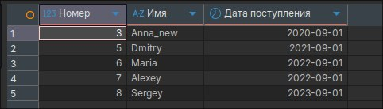
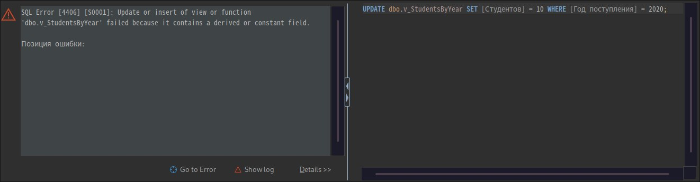

# Лабораторная работа. Представления: три представления, одно модифицируемое

Создание трёх представлений по собственной БД, одно из которых модифицируемое, и проверка изменения данных через представление.

---

## Задание. Три представления по своей БД

### Что требовалось
Реализовать три представления по своей БД, одно из которых должно быть модифицируемым.

### Что сделано
Использована БД `hw` (таблицы `First`–`Fifth` и `Students`). Каждый `CREATE VIEW` должен быть первой инструкцией в пакете, поэтому представления создаются по отдельности.

#### Представление 1. Модифицируемое

Строится на одной таблице, содержит первичный ключ и все столбцы `NOT NULL`, без агрегатов, группировки, `DISTINCT` и подзапросов. `WITH CHECK OPTION` не позволяет через представление добавить или изменить строку так, чтобы она перестала в него попадать.

```sql
use hw;

create VIEW dbo.v_ActiveStudents AS
SELECT id              AS [Номер],
       name            AS [Имя],
       enrollment_date AS [Дата поступления]
FROM Students
WHERE graduation_date IS NULL
WITH CHECK OPTION;
```

#### Представление 2. Немодифицируемое (группировка)

Содержит агрегатные функции и `GROUP BY`, строка представления соответствует группе строк таблицы.

```sql
create VIEW dbo.v_StudentsByYear AS
SELECT YEAR(enrollment_date)  AS [Год поступления],
       COUNT(*)               AS [Студентов],
       COUNT(graduation_date) AS [Выпущено]
FROM Students
GROUP BY YEAR(enrollment_date);
```

#### Представление 3. Немодифицируемое (несколько таблиц)

Объединяет три таблицы цепочки связей.

```sql
create VIEW dbo.v_Chain AS
SELECT f.id     AS [Номер],
       f.name   AS [Первая],
       s.name2  AS [Вторая],
       t.name3  AS [Третья]
FROM First f
INNER JOIN Second s ON s.id = f.id
INNER JOIN Third  t ON t.id = s.id;
```

#### Выборка из представлений

```sql
SELECT * FROM dbo.v_ActiveStudents ORDER BY [Номер];
SELECT * FROM dbo.v_StudentsByYear ORDER BY [Год поступления];
SELECT * FROM dbo.v_Chain ORDER BY [Номер];
```

#### Проверка модифицируемости

Изменение данных через модифицируемое представление:

```sql
UPDATE dbo.v_ActiveStudents SET [Имя] = N'Anna_new' WHERE [Номер] = 3;

INSERT INTO dbo.v_ActiveStudents ([Имя], [Дата поступления]) VALUES (N'Nikita', '2024-09-01');

SELECT * FROM Students WHERE id = 3 OR name = N'Nikita';

DELETE FROM dbo.v_ActiveStudents WHERE [Имя] = N'Nikita';

UPDATE dbo.v_ActiveStudents SET [Имя] = N'Anna' WHERE [Номер] = 3;
```

Попытка изменить данные через немодифицируемые представления:

```sql
UPDATE dbo.v_StudentsByYear SET [Студентов] = 10 WHERE [Год поступления] = 2020;

DELETE FROM dbo.v_Chain WHERE [Номер] = 1;
```

### Результат

`v_ActiveStudents`:

| Номер | Имя | Дата поступления |
|---|---|---|
| 3 | Anna | 2020-09-01 |
| 5 | Dmitry | 2021-09-01 |
| 6 | Maria | 2022-09-01 |
| 7 | Alexey | 2022-09-01 |
| 8 | Sergey | 2023-09-01 |

`v_StudentsByYear`:

| Год поступления | Студентов | Выпущено |
|---|---|---|
| 2020 | 3 | 2 |
| 2021 | 2 | 1 |
| 2022 | 2 | 0 |
| 2023 | 1 | 0 |

`v_Chain`:

| Номер | Первая | Вторая | Третья |
|---|---|---|---|
| 1 | durachok | durachok1 | durachok2 |
| 2 | ishak | ishak1 | ishak2 |
| 3 | duraley | duraley1 | duraley2 |



Изменение через модифицируемое представление: `UPDATE` и `INSERT` отработали, изменения видны в таблице `Students`.


Попытка изменения через немодифицируемые представления завершается ошибкой.



### Анализ
- Представление хранит запрос, а не данные: изменение через модифицируемое представление меняет строки базовой таблицы.
- `v_ActiveStudents` модифицируемо: одна таблица, есть первичный ключ, нет агрегатов, `DISTINCT`, группировки и подзапросов, в списке полей нет выражений, а все обязательные столбцы таблицы (`name`, `enrollment_date`) выбраны, поэтому работает и `INSERT`.
- `WITH CHECK OPTION` запрещает операции, после которых строка выпала бы из представления. Например, вставка студента с датой выпуска через это представление невозможна.
- `v_StudentsByYear` немодифицируемо из-за агрегатных функций и `GROUP BY`: непонятно, какие именно строки таблицы нужно менять.
- `v_Chain` по критериям лекции немодифицируемо, так как строится на нескольких таблицах. В SQL Server обновление столбцов только одной из таблиц через такое представление технически возможно, а вот `DELETE` и `INSERT`, затрагивающие несколько таблиц, невозможны.

### Вывод
Создано три представления с русскими псевдонимами столбцов. Модифицируемым является `v_ActiveStudents`, а представления с группировкой и соединением нескольких таблиц изменять через представление нельзя.

---

## Стек

Microsoft SQL Server, DBeaver.
