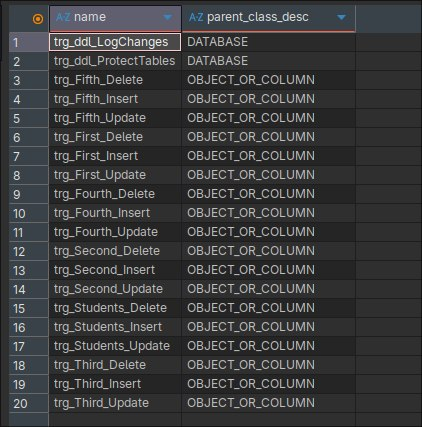
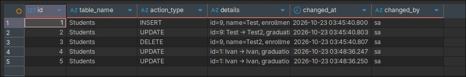
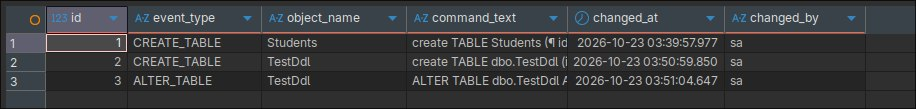
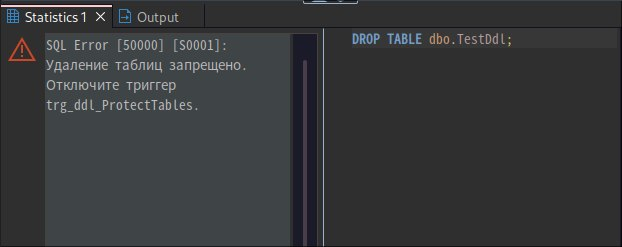

# Лабораторная работа. Триггеры в MS SQL Server

Создание DML-триггеров INSERT, UPDATE и DELETE для каждой таблицы БД и двух DDL-триггеров уровня базы данных.

---

## Задание. Триггеры для таблиц и для БД

### Что требовалось
Написать для каждой таблицы по три триггера (на `INSERT`, `UPDATE` и `DELETE`), а также два триггера для базы данных.

### Что сделано
Использована БД `hw` (таблицы `First`, `Second`, `Third`, `Fourth`, `Fifth` и `Students`). DML-триггеры типа `AFTER` записывают каждое изменение в журнал `AuditLog`. DDL-триггеры уровня `DATABASE` ведут журнал изменений схемы `DdlLog` и защищают таблицы от удаления.

#### Журнальные таблицы

Журналы создаются до триггеров, чтобы DDL-триггер не залогировал их создание.

```sql
use hw;

create TABLE dbo.AuditLog (
	id INT IDENTITY(1,1) PRIMARY KEY,
	table_name NVARCHAR(50) not null,
	action_type NVARCHAR(10) not null,
	details NVARCHAR(300) null,
	changed_at DATETIME not null DEFAULT GETDATE(),
	changed_by NVARCHAR(128) not null DEFAULT SUSER_SNAME()
);

create TABLE dbo.DdlLog (
	id INT IDENTITY(1,1) PRIMARY KEY,
	event_type NVARCHAR(100) null,
	object_name NVARCHAR(200) null,
	command_text NVARCHAR(MAX) null,
	changed_at DATETIME not null DEFAULT GETDATE(),
	changed_by NVARCHAR(128) not null DEFAULT SUSER_SNAME()
);
```

#### DML-триггеры таблицы First

```sql
create TRIGGER dbo.trg_First_Insert ON dbo.First AFTER INSERT AS
INSERT INTO dbo.AuditLog (table_name, action_type, details)
SELECT N'First', N'INSERT', CONCAT(N'id=', id, N', name=', name) FROM inserted;

create TRIGGER dbo.trg_First_Update ON dbo.First AFTER UPDATE AS
INSERT INTO dbo.AuditLog (table_name, action_type, details)
SELECT N'First', N'UPDATE', CONCAT(N'id=', i.id, N': ', d.name, N' -> ', i.name)
FROM inserted i INNER JOIN deleted d ON d.id = i.id;

create TRIGGER dbo.trg_First_Delete ON dbo.First AFTER DELETE AS
INSERT INTO dbo.AuditLog (table_name, action_type, details)
SELECT N'First', N'DELETE', CONCAT(N'id=', id, N', name=', name) FROM deleted;
```

#### DML-триггеры таблицы Second

```sql
create TRIGGER dbo.trg_Second_Insert ON dbo.Second AFTER INSERT AS
INSERT INTO dbo.AuditLog (table_name, action_type, details)
SELECT N'Second', N'INSERT', CONCAT(N'id=', id, N', name2=', name2) FROM inserted;

create TRIGGER dbo.trg_Second_Update ON dbo.Second AFTER UPDATE AS
INSERT INTO dbo.AuditLog (table_name, action_type, details)
SELECT N'Second', N'UPDATE', CONCAT(N'id=', i.id, N': ', d.name2, N' -> ', i.name2)
FROM inserted i INNER JOIN deleted d ON d.id = i.id;

create TRIGGER dbo.trg_Second_Delete ON dbo.Second AFTER DELETE AS
INSERT INTO dbo.AuditLog (table_name, action_type, details)
SELECT N'Second', N'DELETE', CONCAT(N'id=', id, N', name2=', name2) FROM deleted;
```

#### DML-триггеры таблицы Third

```sql
create TRIGGER dbo.trg_Third_Insert ON dbo.Third AFTER INSERT AS
INSERT INTO dbo.AuditLog (table_name, action_type, details)
SELECT N'Third', N'INSERT', CONCAT(N'id=', id, N', name3=', name3) FROM inserted;

create TRIGGER dbo.trg_Third_Update ON dbo.Third AFTER UPDATE AS
INSERT INTO dbo.AuditLog (table_name, action_type, details)
SELECT N'Third', N'UPDATE', CONCAT(N'id=', i.id, N': ', d.name3, N' -> ', i.name3)
FROM inserted i INNER JOIN deleted d ON d.id = i.id;

create TRIGGER dbo.trg_Third_Delete ON dbo.Third AFTER DELETE AS
INSERT INTO dbo.AuditLog (table_name, action_type, details)
SELECT N'Third', N'DELETE', CONCAT(N'id=', id, N', name3=', name3) FROM deleted;
```

#### DML-триггеры таблицы Fourth

```sql
create TRIGGER dbo.trg_Fourth_Insert ON dbo.Fourth AFTER INSERT AS
INSERT INTO dbo.AuditLog (table_name, action_type, details)
SELECT N'Fourth', N'INSERT', CONCAT(N'id=', id, N', name4=', name4) FROM inserted;

create TRIGGER dbo.trg_Fourth_Update ON dbo.Fourth AFTER UPDATE AS
INSERT INTO dbo.AuditLog (table_name, action_type, details)
SELECT N'Fourth', N'UPDATE', CONCAT(N'id=', i.id, N': ', d.name4, N' -> ', i.name4)
FROM inserted i INNER JOIN deleted d ON d.id = i.id;

create TRIGGER dbo.trg_Fourth_Delete ON dbo.Fourth AFTER DELETE AS
INSERT INTO dbo.AuditLog (table_name, action_type, details)
SELECT N'Fourth', N'DELETE', CONCAT(N'id=', id, N', name4=', name4) FROM deleted;
```

#### DML-триггеры таблицы Fifth

```sql
create TRIGGER dbo.trg_Fifth_Insert ON dbo.Fifth AFTER INSERT AS
INSERT INTO dbo.AuditLog (table_name, action_type, details)
SELECT N'Fifth', N'INSERT', CONCAT(N'id=', id, N', name5=', name5) FROM inserted;

create TRIGGER dbo.trg_Fifth_Update ON dbo.Fifth AFTER UPDATE AS
INSERT INTO dbo.AuditLog (table_name, action_type, details)
SELECT N'Fifth', N'UPDATE', CONCAT(N'id=', i.id, N': ', d.name5, N' -> ', i.name5)
FROM inserted i INNER JOIN deleted d ON d.id = i.id;

create TRIGGER dbo.trg_Fifth_Delete ON dbo.Fifth AFTER DELETE AS
INSERT INTO dbo.AuditLog (table_name, action_type, details)
SELECT N'Fifth', N'DELETE', CONCAT(N'id=', id, N', name5=', name5) FROM deleted;
```

#### DML-триггеры таблицы Students

```sql
create TRIGGER dbo.trg_Students_Insert ON dbo.Students AFTER INSERT AS
INSERT INTO dbo.AuditLog (table_name, action_type, details)
SELECT N'Students', N'INSERT', CONCAT(N'id=', id, N', name=', name, N', enrollment=', enrollment_date)
FROM inserted;

create TRIGGER dbo.trg_Students_Update ON dbo.Students AFTER UPDATE AS
INSERT INTO dbo.AuditLog (table_name, action_type, details)
SELECT N'Students', N'UPDATE',
       CONCAT(N'id=', i.id, N': ', d.name, N' -> ', i.name,
              N', graduation: ', d.graduation_date, N' -> ', i.graduation_date)
FROM inserted i INNER JOIN deleted d ON d.id = i.id;

create TRIGGER dbo.trg_Students_Delete ON dbo.Students AFTER DELETE AS
INSERT INTO dbo.AuditLog (table_name, action_type, details)
SELECT N'Students', N'DELETE', CONCAT(N'id=', id, N', name=', name, N', enrollment=', enrollment_date)
FROM deleted;
```

#### DDL-триггеры базы данных

Первый записывает в журнал создание и изменение таблиц, текст команды берётся из `EVENTDATA()`.

```sql
create TRIGGER trg_ddl_LogChanges ON DATABASE
FOR CREATE_TABLE, ALTER_TABLE AS
INSERT INTO dbo.DdlLog (event_type, object_name, command_text)
SELECT EVENTDATA().value('(/EVENT_INSTANCE/EventType)[1]', 'NVARCHAR(100)'),
       EVENTDATA().value('(/EVENT_INSTANCE/ObjectName)[1]', 'NVARCHAR(200)'),
       EVENTDATA().value('(/EVENT_INSTANCE/TSQLCommand/CommandText)[1]', 'NVARCHAR(MAX)');
```

Второй запрещает удаление таблиц.

```sql
create TRIGGER trg_ddl_ProtectTables ON DATABASE
FOR DROP_TABLE AS
BEGIN
	RAISERROR (N'Удаление таблиц запрещено. Отключите триггер trg_ddl_ProtectTables.', 16, 1);
	ROLLBACK;
END;
```

#### Проверка DML-триггеров

```sql
INSERT INTO Students (name, enrollment_date) VALUES (N'Test', '2024-09-01');
UPDATE Students SET name = N'Test2' WHERE name = N'Test';
DELETE FROM Students WHERE name = N'Test2';

UPDATE Third SET name3 = N'durachok2_new' WHERE id = 1;
UPDATE Third SET name3 = N'durachok2' WHERE id = 1;

SELECT * FROM AuditLog ORDER BY id;
```

#### Проверка DDL-триггеров

```sql
create TABLE dbo.TestDdl (id INT);
ALTER TABLE dbo.TestDdl ADD note NVARCHAR(10);

SELECT * FROM DdlLog ORDER BY id;

DROP TABLE dbo.TestDdl;
```

Последняя команда завершается ошибкой, таблица остаётся. Чтобы удалить её, нужно временно отключить триггер:

```sql
DISABLE TRIGGER trg_ddl_ProtectTables ON DATABASE;
DROP TABLE dbo.TestDdl;
ENABLE TRIGGER trg_ddl_ProtectTables ON DATABASE;
```

#### Список триггеров

```sql
SELECT name, parent_class_desc FROM sys.triggers ORDER BY parent_class_desc, name;
```

### Результат

Список созданных триггеров:



Журнал `AuditLog` после вставки, изменения и удаления:



Журнал `DdlLog` после создания и изменения таблицы:



Ошибка при попытке удалить таблицу:



### Анализ
- DML-триггер срабатывает один раз на оператор, даже если затронуто несколько строк, поэтому данные берутся из временных таблиц `inserted` и `deleted` через `SELECT`, а не из скалярных переменных.
- В триггере `INSERT` заполнена только таблица `inserted`, в триггере `DELETE` только `deleted`, а при `UPDATE` в `deleted` лежат старые значения, в `inserted` новые. Поэтому для `UPDATE` они соединяются по `id`.
- Триггеры `AFTER` выполняются после проверки ограничений. Если нарушен внешний ключ (например, удаление строки `First`, на которую ссылается `Second`), оператор отклоняется и триггер не запускается.
- Триггер и вызвавший его оператор выполняются в одной транзакции, поэтому `ROLLBACK` в DDL-триггере отменяет и сам `DROP TABLE`.
- DDL-триггеры срабатывают после выполнения команды и не создают таблиц `inserted` и `deleted`. Данные о событии берутся из функции `EVENTDATA()`.
- Из-за отката в `trg_ddl_ProtectTables` попытки удаления в `DdlLog` не фиксируются, поэтому логируются только `CREATE_TABLE` и `ALTER_TABLE`.

### Вывод
Для всех шести таблиц созданы триггеры на вставку, изменение и удаление (18 штук), которые ведут журнал изменений. На уровне базы данных созданы два DDL-триггера: журнал изменений схемы и защита таблиц от удаления.

---

## Стек

Microsoft SQL Server, DBeaver.
